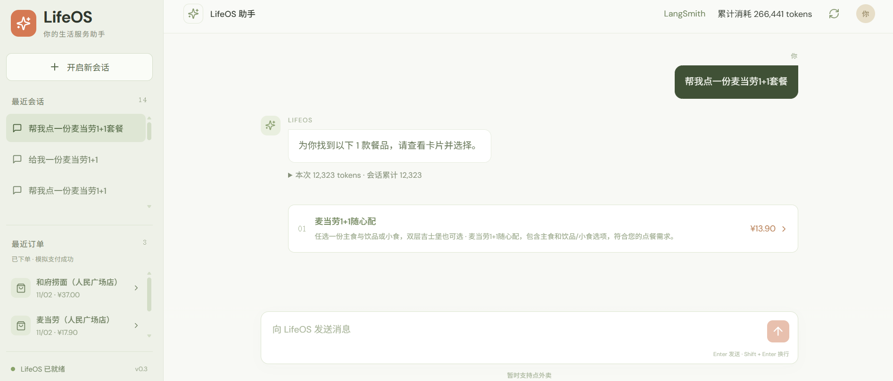
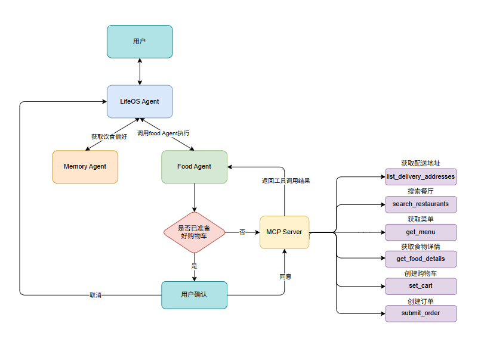
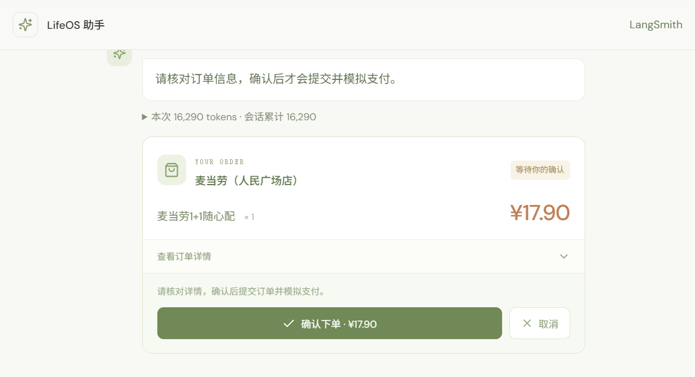
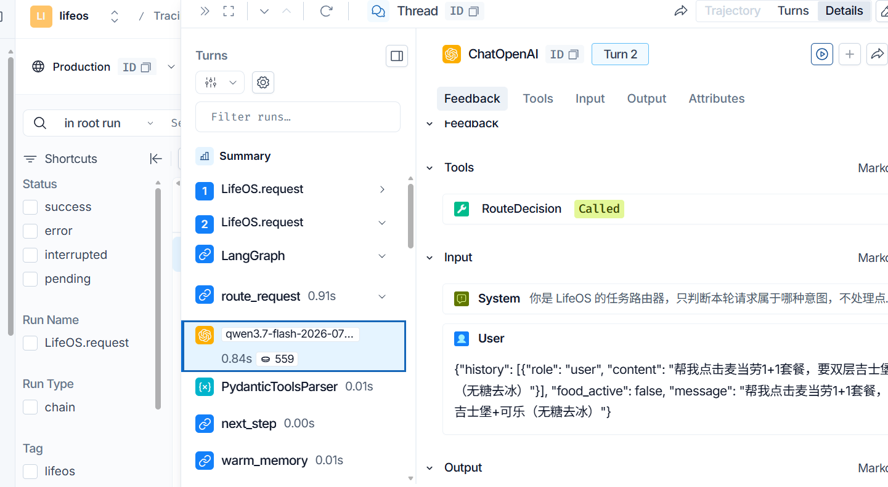
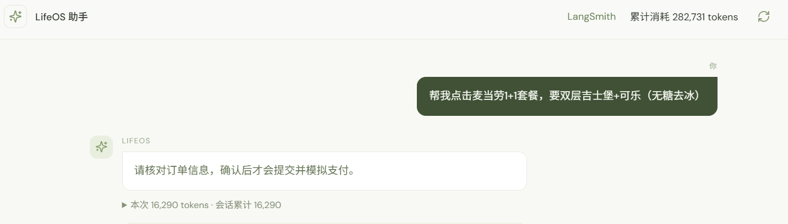

# LifeOS Agent

## 1. LifeOS Agent

LifeOS 是一个生活服务 Agent，目前专注于点外卖。以往需要在外卖 App 中搜索餐厅、浏览餐品、选择规格、加入购物车并下单；现在可以直接描述需求，由 LifeOS 协调查询与选餐，在展示订单预览后等待用户确认，再提交模拟订单。

LifeOS 也能记住用户明确表达的长期饮食偏好，并结合偏好推荐餐厅和餐品。偏好不会代替用户选择本次必填的甜度、温度等规格。当前项目使用模拟外卖平台与模拟支付，不接入真实外卖或支付服务。



## 2. 架构

- **LifeOS Agent**：统一接收会话消息，判断点餐、饮食记忆或其他请求，并协调子图。
- **Food Agent**：按需查询餐厅、菜单和餐品详情，推荐候选、补齐规格、准备购物车，并在人工确认后处理订单。
- **Memory Agent**：提取、纠正、查询和忘记长期饮食偏好；从成功订单中积累正向选择证据。
- **外卖 MCP Server**：提供地址、餐厅、餐品、购物车和订单工具。Food Agent 通过 MCP 客户端访问模拟平台。

下图是简化的模块关系示意。实际下单顺序是先调用 `set_cart` 获取预览，用户确认后再由程序调用 `submit_order`。



## 3. 项目结构


| 目录                         | 职责                                                                     |
| ---------------------------- | ------------------------------------------------------------------------ |
| `backend/app/agents/lifeos/` | 父图状态、结构化意图路由、子图输入输出转换与顶层恢复入口。               |
| `backend/app/agents/food/`   | 点餐状态、提示词、MCP 工具适配、节点、工作流、服务入口和运行时上下文。   |
| `backend/app/agents/memory/` | 饮食偏好提取、纠正、忘记及成功订单证据学习。                             |
| `delivery_mcp/`              | 独立的模拟外卖平台、7 个 MCP 工具、字段 schema、餐厅餐品数据和订单逻辑。 |
| `frontend/`                  | 单列会话、候选列表、消息内订单卡片、展开详情和最近成功订单。             |
| `shared/`                    | 共享配置、数据库路径与 SQLite 连接策略，不承担跨模块业务访问。           |

会话、饮食偏好、平台数据和 LangGraph checkpoint 使用同一个本地 SQLite 文件，但由各模块分别管理自己的表。更多实现细节见 [设计文档](docs/design-v3.md)。

## 4. 人工介入

Food Agent 调用 `set_cart` 后，平台返回餐品、规格、配送地址、费用和预计送达时间。LangGraph 在提交订单前通过 `interrupt` 暂停，页面展示确认卡片。用户可以**确认下单**或**取消**；只有确认后，工作流恢复并调用 `submit_order`。取消不会下单或支付。



## 5. LangSmith 运行轨迹

可选接入 LangSmith，查看 LifeOS 路由、Food 与 Memory 子图、模型请求、MCP 工具调用及各步耗时和用量。复制 `.env.example` 为 `.env` 后，可在其中启用美国区追踪：

```dotenv
LANGSMITH_TRACING=true
LANGSMITH_API_KEY=LangSmith密钥
LANGSMITH_PROJECT=lifeos-agent-dev
LANGSMITH_ENDPOINT=https://api.smith.langchain.com
```

重启后端后，在 LangSmith 项目中打开 `LifeOS.request` 轨迹。模型调用的 Input 才是实际发送给模型的内容；图节点的 Input 是工作流状态。追踪内容会发送到配置的 LangSmith 服务，项目在上传前尽力脱敏，但自由文本无法保证完全覆盖敏感信息。



## 6. Token 消耗展示

页面右上角显示所有会话的累计 Token 消耗，回复下方可展开本次交互的输入、输出和当时的会话累计。统计来自模型返回的 usage，并由本地 SQLite 持久化；没有模型调用的操作记为 0，模型未返回 usage 或调用中断时可能无法准确统计，不能替代模型服务商账单。



## 7. 支持的模型

后端通过 `langchain-openai` 的 `ChatOpenAI` 接入 **OpenAI 兼容接口**，不需要豆包或千问专用 SDK。模型密钥只写在本机 `.env`。以下是两组选一的配置示例；模型 ID 和接口地址以账号控制台提供的值为准。

**豆包示例：**

```dotenv
OPENAI_API_KEY=豆包密钥
OPENAI_BASE_URL=https://ark.cn-beijing.volces.com/api/v3
OPENAI_MODEL=doubao-seed-2-1-lite-260915
```

**千问示例：**

```dotenv
OPENAI_API_KEY=千问密钥
OPENAI_BASE_URL=https://maas.qianwenaiapi.com/compatible-mode/v1
OPENAI_MODEL=qwen3.7-flash-2026-07-15
```

模型名以 `qwen` 开头时，项目默认发送 `enable_thinking=false`；兼容模型也可通过 `OPENAI_ENABLE_THINKING=false` 显式设置。更换模型配置后需要重启后端。兼容接口是否支持项目使用的工具调用与结构化输出，需要用所选模型实际验证。

## 8. 安装与运行

需要 Python 3.11+ 和 Node.js 22.12+（或 20.19+）。在 Windows PowerShell 中从项目根目录执行：

```powershell
.\scripts\setup.ps1
```

脚本创建 `.venv`、安装 Python 与前端依赖，并初始化模拟数据。若默认 `python` 不是合适版本，可使用 `-Python` 指定解释器路径。安装后从 `.env.example` 复制出 `.env`，填写第 7 节的模型配置。

**使用构建好的前端时，只需启动两个服务：**

```powershell
# 终端 1：外卖 MCP 服务
.\scripts\start-mcp.ps1
```

```powershell
# 终端 2：LifeOS 后端；在 MCP 启动后运行
.\scripts\start-backend.ps1
```

打开 [http://127.0.0.1:8000](http://127.0.0.1:8000)，API 文档位于 [http://127.0.0.1:8000/docs](http://127.0.0.1:8000/docs)。首次运行或修改前端后，先在 `frontend` 目录运行 `..\npm.cmd run build`，再启动或重启后端，使其提供最新构建页面。
