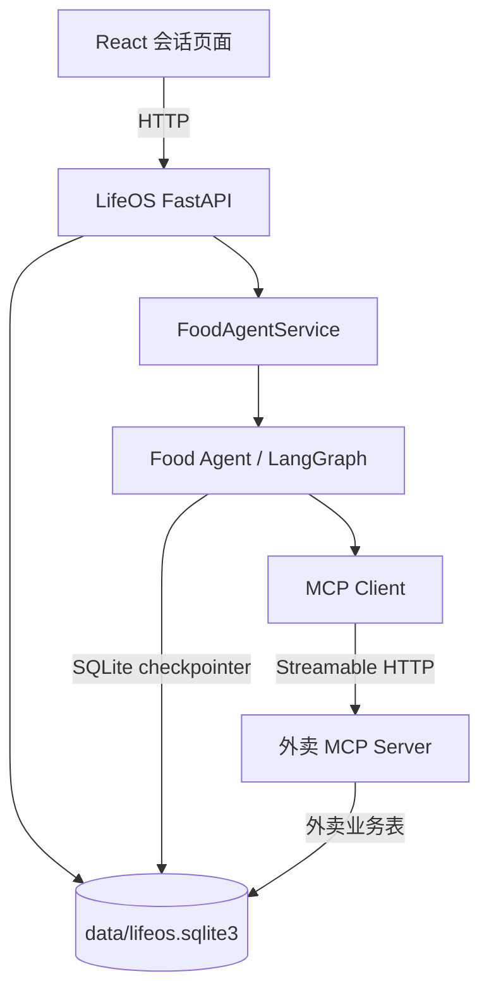
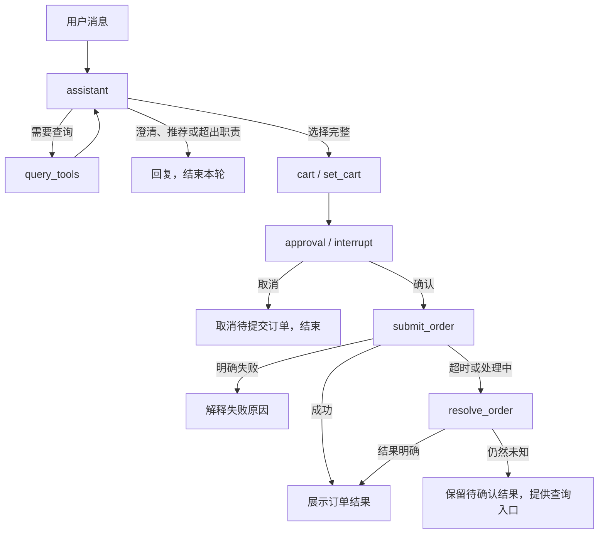

# LifeOS Agent 第二版设计文档

- 日期：2026-11-01
- 状态：讨论结论，作为后续重构和实现依据
- 项目目标：构建可在本地运行、可在 GitHub 展示的生活服务助手，首个业务 Agent 为外卖 Food Agent。
- 三个模块已完成重构。后续讨论修订：移除无密钥规则模式，采用函数式节点和运行上下文，实际运行必须配置模型。

## 1. 目标与范围

LifeOS 是生活服务助手的统一入口，后续可以接入多个业务 Agent。本版只实现 Food Agent，完成需求理解、菜单查询、候选推荐、套餐规格选择、购物车预览、人工确认、模拟下单支付和订单结果查询。

项目由三个模块组成：

| 模块 | 职责 |
| --- | --- |
| 前端会话页面 | 新建和切换会话，收发消息，展示候选、订单确认卡片及订单结果 |
| LifeOS 后端 | FastAPI 接口、会话管理、Food Agent、LangGraph 工作流、MCP Client |
| 模拟外卖 MCP Server | 地址、餐厅、菜单、购物车、模拟订单和支付能力 |

本版明确采用以下简化：

- 使用模拟外卖业务数据，不连接真实外卖平台，不产生真实支付。
- 一个购物车和订单只对应一家餐厅，默认立即配送。
- 不设置独立报价工具、报价节点、报价有效期或报价校验失败分支。
- 购物车结果默认有效，包含最终订单预览所需的信息。
- 人工确认阶段只支持确认和取消，不支持修改订单。
- 取消后结束本次待提交订单；再次点餐由用户重新发起。
- 正常点餐过程仍需澄清缺失的餐品选择和必选规格。
- 当前不实现多个业务 Agent 的路由和协作。

## 2. 技术方案与模块边界

| 部分 | 方案 |
| --- | --- |
| 后端 | Python 3.12、FastAPI |
| Agent 编排 | LangGraph |
| 模型接入 | `langchain-openai` / OpenAI 兼容接口，连接 Doubao Lite 2.1；模型名称和端点可配置 |
| 人工介入 | LangGraph `interrupt` 与 `Command(resume=...)` |
| 状态持久化 | 官方 SQLite checkpointer |
| 外卖工具服务 | Python MCP Server，独立进程，Streamable HTTP |
| 前端 | React、TypeScript、Vite |
| 数据存储 | 项目内共用一个本地 SQLite 文件 |
| 无密钥自动化测试 | 仅在测试中显式注入模型响应替身，生产路径必须配置实际模型 |



职责约定：

- MCP Server 定义工具业务、字段、金额单位、参数约束、输出结构和业务错误。
- Food Agent 发现并消费工具契约，负责对话、流程控制和人工介入。
- 前端根据后端结构化状态渲染卡片，不通过匹配助手文本判断是否出现确认按钮。
- 共享数据库不改变服务调用边界：Food Agent 不直接访问外卖业务表。
- MCP 提交工具不放入模型可自由执行的查询工具集合，只能由确认后的下单节点调用。

## 3. 目标目录

```text
lifeos_agent/
├── backend/
│   ├── app/
│   │   ├── main.py                 # FastAPI 与生命周期
│   │   ├── api/                    # 会话、消息、人工确认与订单查询接口
│   │   ├── core/
│   │   │   ├── config.py           # 路径、模型、MCP 等配置
│   │   │   ├── llm.py              # OpenAI 兼容客户端
│   │   │   ├── database.py         # 业务连接与初始化
│   │   │   └── checkpointer.py     # SQLite checkpointer 生命周期
│   │   ├── repositories/          # LifeOS 会话、消息、确认记录
│   │   └── agents/
│   │       └── food/
│   │           ├── state.py        # 流程状态与少量内部数据结构
│   │           ├── prompts.py      # 助手规则和提示词
│   │           ├── tools.py        # MCP 加载、允许列表与结果适配
│   │           ├── nodes.py        # 工作流节点
│   │           ├── workflow.py     # 构图与编译
│   │           ├── service.py      # 外部调用入口
│   │           └── context.py      # 通过 Runtime 注入的运行依赖
│   └── tests/
├── delivery_mcp/
│   ├── server.py                   # MCP 入口和工具注册
│   ├── schemas.py                  # 平台输入输出契约及字段说明
│   ├── services.py                 # 查询、购物车、订单与模拟支付业务
│   ├── repository.py               # 外卖业务数据访问
│   ├── seed.py                     # 模拟数据初始化
│   └── tests/
├── frontend/
├── data/
│   └── lifeos.sqlite3              # 运行生成，不提交 Git
├── docs/
│   └── design-v2.md
├── scripts/                        # 初始化和启动脚本
├── .env.example
└── README.md
```

不为每个工具单独创建节点文件。`nodes.py` 和 `tools.py` 先保持单文件；内部结构变复杂后再拆分。平台业务 schema 由 MCP 服务维护，Agent 不手工复制整套平台字段说明。

## 4. 核心业务数据

### 4.1 统一字段约定

- 金额：整数分，例如 `1390` 表示人民币 13.90 元；货币为 `CNY`。
- 距离：整数米，字段使用 `distance_meters`。
- 时间：带时区的 ISO 8601；预计配送时长可用最短/最长分钟数表达。
- 业务对象均使用稳定 ID；名称用于展示，工具串联使用 ID。
- 查询列表支持分页；空结果是正常业务结果。
- 查询结果中的距离、配送时间和费用以选定地址为基准。

### 4.2 配送地址

`address_id`、联系人、脱敏电话、区域、详细地址、是否默认。演示预置少量可选地址，当前不做地址增删改。存在多个地址且没有已选地址时让用户选择；会话已选择的地址可继续使用。

### 4.3 餐厅

`restaurant_id`、`name`、门店地址、`distance_meters`、预计配送时长范围、`delivery_fee`、`minimum_order_amount`、`tags`、五分制 `rating`、`rating_count`、`business_status`、`delivery_available`。

标签可以是龙虾烧烤、便当简餐、奶茶咖啡等。当前简化版只返回可正常完成演示点餐的餐厅；相关字段用于展示和筛选，不引入结算失败流程。

### 4.4 菜单与餐品

菜单分类由餐厅自行维护，包含 `category_id`、`name`、`sort_order`。一个餐品可以属于多个分类，例如热销、优惠、饮品。

餐品字段包括：`food_id`、`restaurant_id`、`name`、`description`、`image_url`、`category_ids`、`tags`、`base_price`、`original_price`、`portion_description`、`packaging_fee`、`availability`、`option_groups`。

选项组采用通用结构：

```json
{
  "group_id": "temperature",
  "name": "温度",
  "required": true,
  "min_select": 1,
  "max_select": 1,
  "options": [
    {"option_id": "normal_ice", "name": "正常冰", "price_delta": 0},
    {"option_id": "no_ice", "name": "去冰", "price_delta": 0}
  ]
}
```

温度、甜度、辣度、份量和套餐组成均可使用选项组。套餐组件支持子选项：选择可乐后才能选择温度，选择薯条时不出现可乐的温度选项。工具返回合法选项，模型不自行发明规格。

### 4.5 购物车与订单

购物车包含 `cart_id`、`cart_version`、餐厅、餐品明细、配送地址快照、预计送达时间、商品小计、包装费、配送费、优惠和应付总额。

购物车餐品包含 `food_id`、数量以及所选选项 ID。平台根据目录计算金额，客户端不指定应付金额。本版购物车成功结果默认有效，不产生报价 ID 或报价过期检查。

确认后冻结这份购物车快照。`submit_order` 使用 `cart_id`、`cart_version` 和幂等键，防止提交到其他版本的购物车。

订单记录餐品与地址快照，分别保存订单状态和支付状态，以便表达创建成功但支付失败等结果。支付为模拟行为。

## 5. 外卖 MCP 工具

共 7 个工具。`set_cart` 替代讨论早期的 `prepare_order`，不保留独立报价步骤。

| 工具 | 主要入参 | 主要返回内容 |
| --- | --- | --- |
| `list_delivery_addresses` | 无业务入参，演示用户由服务配置确定 | 地址列表、默认地址 ID |
| `search_restaurants` | 地址 ID、关键词、标签、排序、分页 | 餐厅列表、分页信息 |
| `get_menu` | 餐厅 ID、分类、关键词、预算过滤、分页 | 菜单分类、餐品摘要、分页信息 |
| `get_food_details` | 餐品 ID | 餐品详情、选项组、套餐组件与子选项 |
| `set_cart` | 可选购物车 ID、餐厅 ID、地址 ID、完整餐品列表、备注 | 购物车 ID、版本及完整订单预览 |
| `submit_order` | 购物车 ID、购物车版本、幂等键 | 提交结果、订单 ID、订单及支付状态、错误信息 |
| `get_order` | 订单 ID 或幂等键，至少提供一个 | 是否找到、订单状态、支付状态、订单详情 |

`set_cart` 使用完整列表替换购物车内容，重复调用不会不断累加餐品。购物车仅通过对应 MCP 工具操作。

工具定义提供 `description`、`inputSchema` 和 `outputSchema`；实际结果提供 `structuredContent`，需要兼容文本工具消息时同步提供 JSON 文本。字段说明和单位以 MCP Server 为准。

Agent 的适配层负责保留结构化数据并适配模型消息；模型工具只传名称、简明描述与输入 schema，不把完整输出 schema 拼入描述。金额单位和必要业务规则由 MCP 工具描述简明说明，输出 schema 留在客户端校验结果。关键 ID、金额、确认对象和订单状态由代码读取，不能仅依赖模型文本判断。

缺字段、非法 ID 等协议或调用错误仍返回清晰错误。去掉报价校验分支不意味着忽略工具参数检查；正常演示数据和调用路径默认可以生成有效购物车。

## 6. Food Agent 工作流

### 6.1 节点

| 节点 | 职责 |
| --- | --- |
| `assistant` | 理解上下文，判断职责范围，澄清需求，推荐候选，决定下一步 |
| `query_tools` | 执行地址、餐厅、菜单和详情查询，返回助手继续判断 |
| `cart` | 调用 `set_cart`，保存结构化购物车与订单预览 |
| `approval` | 创建确认事项并触发人工中断，接收确认或取消 |
| `submit_order` | 持久化并复用幂等键，提交订单并模拟支付 |
| `resolve_order` | 查询超时或处理中的订单，执行有界重试与状态同步 |



### 6.2 典型对话

1. **需求清楚**：用户说“麦当劳 1+1，双层吉士堡和无糖冰可乐”。查询可配送门店、菜单和规格，映射到合法选项，设置购物车，展示订单预览，人工确认后提交。用户提到的价格需以目录和购物车实际金额展示。
2. **需求模糊**：用户说“给我点个汉堡”。搜索菜单，最多推荐三个候选，说明价格、配送等依据。用户选择后补齐必选规格，再设置购物车。无依据时不宣称绝对最优。
3. **职责无关**：用户要求搜集新闻，说明 Food Agent 的职责并结束本轮。未来由 LifeOS 总入口路由其他能力。
4. **取消**：待确认时点击取消，结束该待提交订单，不调用下单工具。
5. **超时**：提交结果未知，自动查询，仍无法确认则保留状态并向用户提供后续查询入口。

“第二个”“无糖”“取消”等表达必须结合会话上下文理解。询问口味或让用户选择候选时，通常回复并结束本轮；下一条消息继续执行。只有订单确认使用 LangGraph 人工中断。

### 6.3 状态

`FoodState` 至少保存：

- 消息上下文和本轮处理结果。
- 已选择的地址、餐厅、餐品与规格。
- 结构化候选列表，支持前端点击选择。
- 购物车 ID、版本与完整预览快照。
- 当前 `approval_id`、确认状态。
- 幂等键、订单 ID、订单状态和支付状态。
- 最近错误及结果查询所需状态。

对外会话状态使用：`idle`、`processing`、`awaiting_confirmation`、`order_pending`。订单成功、失败、取消作为明确结果保存。`order_pending` 时优先查询已有提交结果，不把同一次确认重新变成一笔新订单。

### 6.4 外部调用入口

`workflow.py` 提供 `build_graph(checkpointer)`，显式注册 `nodes.py` 中的普通节点函数。FastAPI 启动时创建并复用 Graph，各会话使用不同 `thread_id`。模型、MCP Client 和 Repository 通过 `FoodContext` 与 `Runtime` 注入，Service 的所有执行与恢复调用均传入 `context=`，不把连接或模型对象写进状态。

`service.py` 提供：

```python
async def chat(thread_id: str, message: str): ...
async def resume(thread_id: str, decision: ApprovalDecision): ...
async def get_session(thread_id: str): ...
async def refresh_order(thread_id: str): ...
```

人工恢复数据包含 `approval_id` 和 `action: confirm | cancel`。服务端校验该确认事项属于当前会话、仍待处理且对应当前购物车。恢复时使用同一 `thread_id` 和 `Command(resume=...)`。

确认按钮提交成功后失效；同一会话的状态变更请求串行处理，避免消息与确认同时执行。重复确认应返回已有处理状态，不创建新幂等键。

## 7. 提交结果与超时处理

工具调用结果与业务状态分别表达：

| 提交结果 | 含义 | 处理 |
| --- | --- | --- |
| `succeeded` | 创建及模拟支付成功 | 展示订单结果 |
| `rejected` | 明确失败 | 展示可理解原因 |
| `pending` | 已受理，仍在处理 | 查询订单 |
| `unknown` | 无法确定是否已经提交成功 | 按原幂等键查询 |

网络超时也可能由客户端异常表示，由适配层转换成结果未知的处理路径。

默认策略：

1. 提交前生成并持久化幂等键。
2. 超时后立即按幂等键查询订单。
3. 若仍不明确，以 1、2、4 秒间隔追加查询，重试次数由代码控制。
4. 本版优先查询，不自动换键重新提交。若以后支持重发，只允许复用原键和原购物车版本。
5. 仍不明确时保留 `order_pending`，说明“订单结果暂未确认”，展示请求编号和查询入口。
6. `get_order` 暂未找到不能直接推断下单失败。

平台在数据库中对幂等键设置唯一约束。同一键重复提交返回同一业务结果；相同键绑定不同购物车内容时拒绝处理。不能只依靠前端按钮禁用保证幂等。

## 8. 前端与 API

### 8.1 页面功能

1. 会话列表：新建、切换会话。
2. 消息区域：显示用户及助手消息、处理中状态和请求失败提示。
3. 推荐展示：展示候选餐厅和餐品，点击后携带对象 ID 提交选择。
4. 订单确认卡片：餐厅、餐品、规格、数量、地址、金额明细、预计送达时间，提供确认和取消按钮。
5. 订单结果：成功、失败或待确认；待确认时可继续查询。
6. 会话恢复：刷新后恢复历史消息、订单卡片和当前待处理状态。

模型文本用于解释，卡片来自后端结构化数据。选择候选时后端验证 ID 属于当前候选，模型不能把前端传入内容视为已完成下单授权。

### 8.2 建议接口

| 接口 | 用途 |
| --- | --- |
| `POST /api/sessions` | 新建会话 |
| `GET /api/sessions` | 会话列表 |
| `GET /api/sessions/{id}` | 历史消息与当前会话状态 |
| `POST /api/food/chat` | 发送消息或结构化候选选择 |
| `POST /api/food/resume` | 确认或取消指定人工确认事项 |
| `POST /api/food/sessions/{id}/order/refresh` | 查询并同步当前订单结果 |
| `GET /api/health` | 健康状态 |

本版可使用普通 HTTP 请求，等待时显示处理中；暂不要求流式输出。消息提交携带 `client_message_id`，用于请求重发去重。

响应至少包含 `session_id`、会话状态、助手消息和可选的结构化卡片。确认卡片携带 `approval_id`，不通过解析消息文本恢复确认状态。

## 9. 共用 SQLite

统一配置绝对数据库路径，默认 `data/lifeos.sqlite3`，避免不同进程工作目录导致创建多个文件。

| 所有方 | 表与内容 |
| --- | --- |
| LifeOS | `sessions`、`messages`、`approvals`：会话元数据、可展示消息、确认对象与处理结果 |
| 外卖平台 | `delivery_addresses`、`delivery_restaurants`、`delivery_categories`、`delivery_foods`、规格相关表、`delivery_carts`、`delivery_orders` |
| Checkpointer | 由官方 SQLite checkpointer 自行创建和维护的表 |

原则：

- `session_id` 与 LangGraph `thread_id` 使用同一个值。
- UI 消息记录与 checkpoint 各有用途：前者用于页面展示，后者用于恢复执行，不要求前端直接读取 checkpoint。
- LifeOS 消息和 Agent 消息通过稳定 ID 关联，恢复或重试时避免重复记录。
- 各进程独立建立连接，启用 WAL、锁等待时间与外键约束，使用短事务。
- 等待模型、网络或人工输入时不持有数据库写事务。
- 业务写入与 checkpoint 保存不会自动成为同一事务，依靠幂等键处理订单提交后的恢复。
- 应用启动时初始化各自拥有的表；模拟数据初始化可重复运行，不覆盖用户已有订单。
- 不提交运行数据库、密钥、虚拟环境或依赖目录；提交 schema 初始化、模拟数据脚本和依赖锁文件。

## 10. 演示、验证和交付

实际运行只使用模型决策，不保留无密钥规则模式。缺少密钥时启动失败，模型调用失败时明确提示。自动化测试可以显式注入测试专用模型响应，验证同一工作流和 MCP 工具的编排、人工确认和恢复行为；不把预设响应当作真实意图识别效果。

模拟平台通过配置或测试夹具提供成功、明确失败、处理延迟和响应丢失场景，不要求用户在正常点餐文本中触发故障。

关键验收场景：

- 精确输入麦当劳 1+1 及规格，正确展示购物车，确认前没有订单和支付。
- 模糊输入汉堡，推荐不超过三个候选，选择后进入确认。
- 无关需求得到职责说明。
- 点击取消不调用提交工具；确认后返回模拟订单与支付结果。
- 重复点击或重发确认只生成一个订单。
- 刷新页面、重启后恢复会话和待确认事项。
- 提交已成功但响应超时，通过幂等键查询到同一订单。
- 查询仍未知时保留状态，用户后续可继续查询。
- Python 依赖检查、关键业务与恢复测试、前端 TypeScript 检查和生产构建通过。

GitHub 交付包含架构图、启动说明、环境变量示例、模拟数据初始化、演示截图或录屏以及关键测试。明确标注模拟外卖与模拟支付，不要求提交或展示真实 API Key。

## 11. 后续扩展

当前范围完成后，可再考虑多 Agent 路由、订单修改、真实报价和有效期、售罄与起送价校验、真实平台适配、用户认证、独立数据库和流式消息。上述能力不作为本版实现前提。
