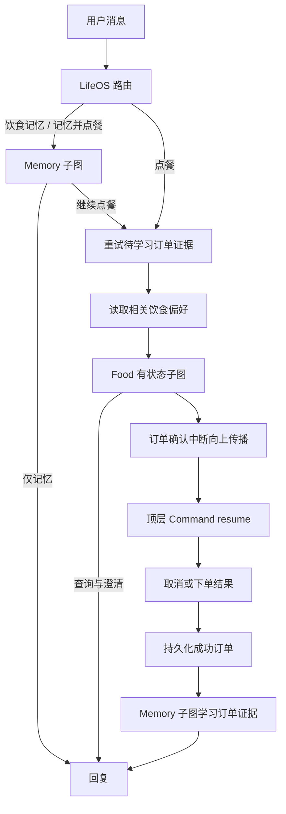

# LifeOS 主子 Agent、饮食记忆与小屏会话页

日期：2026-11-02。此文描述当前实现，早期 Food 设计保留在 `design-v2.md`。

## 工作流

LifeOS 模型结构化路由支持 food / memory / memory_food / unsupported。结构化响应采用 LangChain 的 `with_structured_output(..., method='function_calling')`，沿用 OpenAI 兼容接口，不依赖服务商的额外 JSON Schema 响应功能。

Food 与 Memory 状态独立，父图节点直接调用编译后的子图并转换输入输出。Food 编译为 `checkpointer=True`，在同一会话保留选餐消息；Memory 为默认按次子图。父图编译时配置 SQLite checkpointer，运行依赖通过 `Runtime` 传入。

参考：[官方 Subgraphs](https://docs.langchain.com/oss/python/langgraph/use-subgraphs)、[官方 Interrupts](https://docs.langchain.com/oss/python/langgraph/interrupts)。

Food 中断时父图包装节点还没有返回，所以确认卡片从中断载荷构造；不假设父图已经得到子图输出。恢复重新进入调用节点与子图中断节点，不在调用前执行非幂等业务操作。确认、取消、结果查询不重新调用路由模型。

## 记忆

仅收集餐品、菜系、食材喜恶、口味、甜度和温度，不记录预算、地址、身份和健康信息。

- 明确长期声明直接保存；本次临时要求不保存。
- 订单按实际餐品和规格提取正向证据，不推断未选食材或健康事实。
- 最近 10 笔成功订单中，两个不同订单的相同选择形成推断；同维度优先次数多者，同次数取最近者。
- 明确表达覆盖推断；同主体的新声明覆盖旧声明。
- 忘记使用停用与屏蔽记录，不物理删除；旧订单和后续推断不能自动恢复被忘记的条目，用户明确重新记住时才解除屏蔽。
- 消息和订单来源 ID 去重。订单先保存成功结果，再学习；失败任务保留，后续点餐时有界重试。
- Food 得到本轮偏好快照，只用于推荐，不能据此自动补选规格。用户当前要求优先。

SQLite 新增 `dietary_memories`、`memory_events`、`memory_blocks`、`order_preferences`。执行状态依旧归官方 checkpoint 表，长期记忆不存储在 checkpoint 中。

## API 与订单

新聊天入口：`POST /api/lifeos/chat`。人工恢复：`POST /api/lifeos/resume`。查询当前未知结果：`POST /api/lifeos/sessions/{id}/order/refresh`。会话接口沿用，新增 `GET /api/orders?limit=10`。

消息记录通过 `message_cards` 关联结构化订单卡片，保存购物车快照、确认 ID、结果及偏好来源。每张卡片独立绑定确认事项；查询时更新原卡片，不把它挪到新消息。历史卡片只读，重复确认不生成新订单。

`lifeos_orders` 是平台成功结果的本地投影，仅保存 `succeeded` 且支付状态 `paid` 的订单。最近订单按平台创建时间倒序，默认最多 10 条；点击后在主区域查看只读详情。外卖平台仍为 7 个 MCP 工具，没有为 UI 增加列表工具或直接跨模块读取平台表。

## 兼容与初始化

仅新增表，不清空或重写现有数据。新工作流使用 `lifeos:{session_id}`，旧 Food 使用原 thread ID。已有待确认/未知订单由旧图继续处理；结束后新消息进入 LifeOS。旧客户端 `/api/food/*` 保留，但新前端只调用 LifeOS。

历史订单从已确认的本地审批记录获取幂等键，通过 MCP `get_order` 补齐成功快照。最近十单可进入学习队列，不分析旧聊天全文。数据库仍是单机单用户 SQLite，API 使用单 worker。

## 前端

左侧是最近会话与最近成功订单，各自滚动；主区为单列消息，移除右侧订单栏和大幅首屏装饰。订单卡片默认只显示摘要、总价、状态及确认按钮，使用原生 `details/summary` 在消息内展开完整规格、费用、地址和预计时间。

输入区固定在底部，仅消息区域滚动；窄屏使用可折叠导航。验收尺寸为 1366×768、1280×720，并检查移动端无横向溢出。
